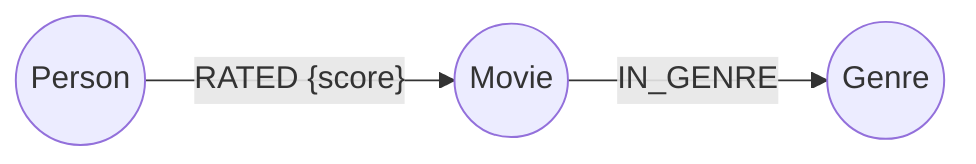

# Recomendador de películas con Neo4j

Autor: Alex David Racero Prado - Universidad de San Buenaventura
Laboratorio de Bases de Datos - Grupo 7

Ejemplo sencillo que muestra para qué sirve **Neo4j**, una base de datos de **grafos** (no relacional): descubrir cosas a partir de cómo están conectados los datos. Funciona con la versión gratuita, ya sea **Community Edition** (local, con Docker) o **AuraDB Free** (en la nube).

## Qué hace

Guarda seis personas que calificaron películas y responde tres preguntas con el lenguaje Cypher:

1. Qué películas vio una persona y cómo las calificó.
2. Qué personas tienen gustos parecidos (calificaron con 4 o 5 las mismas películas).
3. Qué película se le puede recomendar: la que les gustó a esas personas y que la persona aún no ha visto.

La tercera pregunta es la razón de ser de un grafo: se resuelve siguiendo conexiones (persona, película, otra persona, otra película) sin escribir JOIN entre tablas.

## Modelo de datos



| Elemento | Detalle |
|---|---|
| Nodos | `Person {name}`, `Movie {title}`, `Genre {name}` |
| Relaciones | `(Person)-[:RATED {score: 1..5}]->(Movie)` y `(Movie)-[:IN_GENRE]->(Genre)` |
| Datos | 6 personas, 8 películas y 5 géneros (archivo `data/seed.cypher`) |

## Requisitos

- Python 3.9 o superior.
- Una base Neo4j gratuita: una cuenta en AuraDB Free o Docker Desktop instalado.

## Cómo ejecutarlo

### 1. Descargar el proyecto

```bash
git clone https://github.com/Alxxdavid/neo4j-recomendador-peliculas.git
cd neo4j-recomendador-peliculas
```

### 2. Crear el archivo de credenciales

```bash
cp .env.example .env      # en Windows: copy .env.example .env
```

El archivo `.env` está en `.gitignore`, así que nunca se sube al repositorio. Se completa en el paso siguiente según la opción elegida.

### 3. Elegir la base de datos

**Opción A: AuraDB Free (nube)**

1. Entrar a <https://console.neo4j.io> e iniciar sesión o crear una cuenta.
2. Crear una instancia **AuraDB Free**.
3. Al crearla se muestra una contraseña generada. Descargar el archivo de credenciales o copiarla en ese momento, porque no se puede recuperar después.
4. Esperar a que la consola indique que la instancia está lista.
5. Completar `.env` con los valores del archivo de credenciales: `NEO4J_URI` (empieza por `neo4j+s://`), `NEO4J_USERNAME`, `NEO4J_PASSWORD` y, si aparece, `NEO4J_DATABASE`.

**Opción B: Community Edition local con Docker**

1. En `.env` dejar `NEO4J_URI=bolt://localhost:7687` y `NEO4J_USERNAME=neo4j`, y escribir una contraseña propia de al menos 8 caracteres en `NEO4J_PASSWORD`.
2. Levantar la base:

```bash
docker compose up -d
```

Neo4j Browser queda disponible en <http://localhost:7474>.

### 4. Instalar dependencias y ejecutar

```bash
python -m venv .venv
source .venv/bin/activate          # en Windows: .venv\Scripts\activate
pip install -r requirements.txt
python src/main.py
```

En PowerShell, si bloquea la activación del entorno virtual, ejecutar antes `Set-ExecutionPolicy -Scope Process RemoteSigned`.

Opciones del programa:

```bash
python src/main.py --name Luis     # recomendaciones para otra persona
python src/main.py --reset         # borra los datos de ejemplo y los vuelve a cargar
```

El programa se puede ejecutar varias veces: los datos se cargan con `MERGE`, por lo que no se duplican.

## Resultado esperado

Con los datos de ejemplo, para Ana:

```
Conectado a bolt://localhost:7687
Datos de ejemplo cargados.

1) Películas que vio Ana
  pelicula      genero           puntaje
  ------------  ---------------  -------
  Inception     Ciencia ficción  5
  Matrix        Ciencia ficción  5
  Interestelar  Ciencia ficción  4

2) Personas con gustos parecidos a Ana
  persona  peliculas_en_comun  cuales
  -------  ------------------  -------------------------------
  Luis     3                   Inception, Interestelar, Matrix
  Carlos   2                   Interestelar, Matrix
  Sofía    1                   Inception

3) Recomendaciones para Ana
  pelicula    recomendada_por  promedio
  ----------  ---------------  --------
  Parásitos   2                4.5
  El Padrino  1                5.0
```

## Ver el grafo

Después de ejecutar el programa, abrir la herramienta **Query** de AuraDB (o Neo4j Browser en `http://localhost:7474` si se usa Docker) y ejecutar:

```cypher
MATCH (person:Person)-[rating:RATED]->(movie:Movie)-[:IN_GENRE]->(genre:Genre)
RETURN person, rating, movie, genre
```

Para ver el camino que usa la recomendación de Ana:

```cypher
MATCH path = (:Person {name: "Ana"})-[:RATED]->(:Movie)<-[:RATED]-(:Person)-[:RATED]->(:Movie)
RETURN path
```

## Estructura del proyecto

- `src/main.py`: punto de entrada, argumentos y flujo del programa.
- `src/config.py`: lectura de variables de entorno y constantes de configuración.
- `src/database.py`: acceso a Neo4j (clase `MovieGraphRepository`).
- `src/queries.py`: consultas Cypher.
- `src/report.py`: impresión de resultados en tablas.
- `src/errors.py`: errores propios del programa.
- `data/seed.cypher`: restricciones y datos de ejemplo.
- `docker-compose.yml`: Neo4j Community local.
- `.env.example`: plantilla de credenciales, sin valores reales.

## Seguridad

- No hay contraseñas ni claves en el código ni en el repositorio.
- Las credenciales se leen del archivo `.env` o de variables de entorno.
- Si una clave se publica por error, hay que cambiarla de inmediato en Neo4j o AuraDB.

## Referencias

- Neo4j: <https://neo4j.com>
- Manual de Cypher: <https://neo4j.com/docs/cypher-manual/current/>
- Driver oficial de Python: <https://neo4j.com/docs/python-manual/current/>
- AuraDB Free: <https://neo4j.com/cloud/aura-free/>
